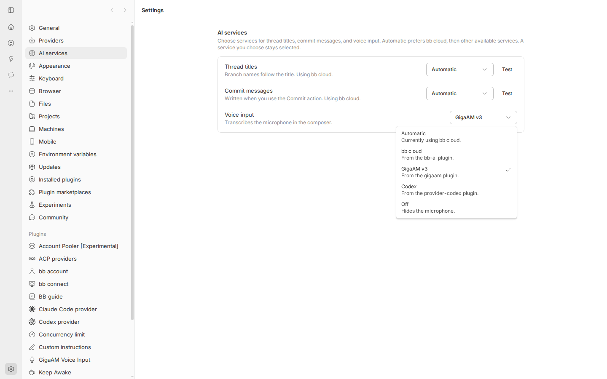
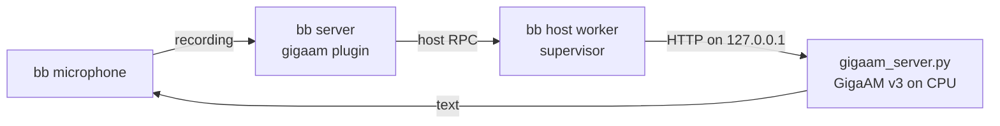
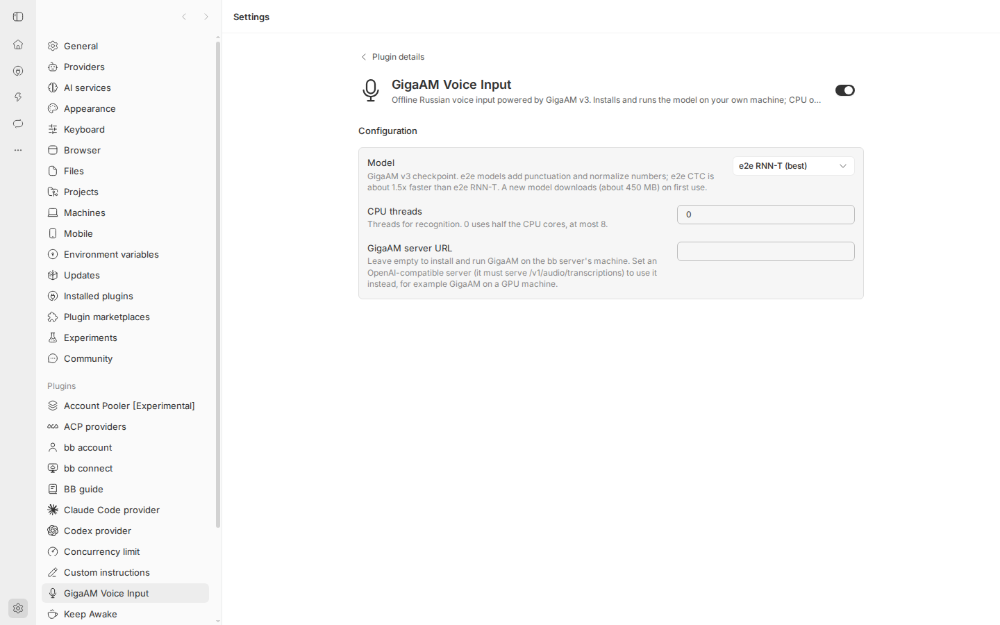

# GigaAM Voice Input for bb

**Offline Russian speech-to-text for the [bb](https://getbb.app) microphone button, powered by [GigaAM v3](https://github.com/salute-developers/GigaAM).**

Press the mic in any bb chat, speak Russian, get punctuated text. The plugin installs and runs the model on your own machine: no API keys, no GPU, no audio sent to third parties.

[](./LICENSE)
[](https://getbb.app)
[](https://github.com/salute-developers/GigaAM)



## Features

- **Zero setup.** On first load the plugin downloads [uv](https://github.com/astral-sh/uv), a private Python 3.12, CPU-only PyTorch, GigaAM, and the model into its own data directory. It needs no root, Docker, system Python, or ffmpeg.
- **Strong Russian recognition.** GigaAM v3 e2e models punctuate and normalize text. Sber reports a 70:30 side-by-side win over Whisper-large-v3 on Russian.
- **Fast on CPU.** About 1 s for a 10 s phrase and about 7 s for a minute of speech on a 10-core server.
- **Long dictation.** Recordings over 20 s are split at pauses and decoded in one batch, so multi-minute voice notes work.
- **Private.** Audio goes from bb to a server on `127.0.0.1` and nowhere else.
- **Self-healing.** The plugin restarts the server if it crashes, after bb restarts, and when you change the model.
- **Bring your own server.** Point the plugin at any OpenAI-compatible `/v1/audio/transcriptions` endpoint, for example GigaAM on a GPU machine.

## Requirements

| | |
|---|---|
| bb | 0.46 or newer |
| OS | Linux x86-64 or arm64, or macOS on Apple silicon. Tested on Ubuntu 24.04 x86-64. |
| Disk | About 2 GB: the Python environment and one model |
| RAM | About 1.5 GB while the model is loaded |
| Network | Needed for the first install only (about 1.2 GB of downloads) |

Windows and Intel Macs cannot run the bundled server. On them, set **GigaAM server URL** to a server running elsewhere.

## Install

From the bb Community catalog, once it is listed:

```sh
bb plugin install gigaam
```

Or straight from GitHub:

```sh
bb plugin install git:https://github.com/AiXenix/bb-plugin-gigaam@^0.1.0
```

Then make it the voice input service. Use **Settings → AI services → Voice input → GigaAM v3**, or run:

```sh
bb settings ai-services set voice gigaam
```

The first install takes 3–10 minutes, depending on your connection. Until it finishes, bb shows the progress next to the service in Settings → AI services and hides the microphone. Follow it from a terminal:

```sh
bb gigaam status
```

```text
Status:    ready (Serving v3_e2e_rnnt)
Model:     v3_e2e_rnnt
Threads:   auto
Platform:  linux-x64
Data dir:  /home/me/.bb/plugins/gigaam/host-data
Server:    http://127.0.0.1:41873
```

## How it works



1. bb hands each recording to the plugin's voice service (`bb.experimental_aiServices`).
2. The service forwards it to the plugin's host entry, which runs on the bb server's machine.
3. The host entry owns a small FastAPI server ([`python/gigaam_server.py`](python/gigaam_server.py)). The server decodes the audio with ffmpeg, cuts long recordings at pauses, and runs GigaAM.
4. The transcript goes back to bb and appears in the message box.

The host entry keeps the model loaded between recordings, so only the first start after boot waits for model loading (about 10 s).

## Settings

Edit them in **Settings → Plugins → GigaAM Voice Input**, or with `bb plugin config gigaam set <key> <value>`.



| Key | Default | Meaning |
|---|---|---|
| `model` | `v3_e2e_rnnt` | GigaAM checkpoint; see [Models](#models) |
| `threads` | `0` | CPU threads for recognition. `0` uses half the cores, at most 8 |
| `serverUrl` | empty | Use an external OpenAI-compatible server instead of the managed one |

## Models

| Model | Output | Speed |
|---|---|---|
| `v3_e2e_rnnt` (default) | Punctuation, capitalization, normalized numbers | 1× |
| `v3_e2e_ctc` | Punctuation, capitalization | about 1.5× faster |
| `v3_rnnt` | Lowercase, no punctuation | |
| `v3_ctc` | Lowercase, no punctuation | fastest |

Changing the model downloads it on first use (about 450 MB) and restarts the server.

## Commands

| Command | What it does |
|---|---|
| `bb gigaam status [--json]` | Install and server state, model, data directory |
| `bb gigaam logs [--lines N]` | Tail of the install and server logs |
| `bb gigaam restart` | Restart the server and reload the model |
| `bb gigaam reinstall` | Rebuild the Python environment from scratch |
| `bb voice transcribe <file>` | Built into bb: transcribe a file with the selected service |

## Use an external server

Run the bundled server anywhere with Python 3.10+ and GigaAM installed:

```sh
pip install "gigaam @ https://github.com/salute-developers/GigaAM/archive/7447938d791c4f3e643386ee22c33777004293a5.tar.gz" \
  torch torchaudio fastapi uvicorn python-multipart imageio-ffmpeg
python python/gigaam_server.py --host 0.0.0.0 --port 8765 --model v3_e2e_rnnt
```

Then set the plugin to use it:

```sh
bb plugin config gigaam set serverUrl http://gpu-box:8765
```

Any server with an OpenAI-compatible `POST /v1/audio/transcriptions` works the same way. The server has no authentication, so keep it on a private network.

## Agent skill

The plugin ships the `gigaam-voice` skill ([`skills/gigaam-voice/SKILL.md`](skills/gigaam-voice/SKILL.md)). bb agents use it to check, configure and troubleshoot voice input: `bb gigaam status | logs | restart | reinstall`, settings and limits.

## See also

[**Meetings for bb**](https://github.com/AiXenix/bb-plugin-meetings): a Zoom notetaker that records meetings and transcribes them with this GigaAM server, split by speaker.

## Troubleshooting

- **The microphone is missing.** The service is not ready yet. Run `bb gigaam status`, and check Settings → AI services for the message.
- **The install failed.** Run `bb gigaam logs` to find the failing step. Fix the cause (usually network or disk space), then run `bb gigaam reinstall`. A failed install also retries on its own, with backoff up to one hour.
- **English words come out in Cyrillic.** GigaAM v3 recognizes Russian only, and the vocabulary hint from bb is ignored.
- **The plugin uses too much CPU.** Lower `threads`, or switch to `v3_e2e_ctc`.

## Uninstall

```sh
bb plugin remove gigaam
```

bb deletes the plugin, but the downloaded environment and models stay in the data directory shown by `bb gigaam status` (usually `~/.bb/plugins/gigaam/host-data`). Delete that directory to free about 2 GB.

## Development

```sh
npm install
npm test                    # unit tests with the bb plugin SDK harness
GIGAAM_E2E=1 npm test       # real install + transcription (downloads ~1.5 GB)
npm run typecheck
npm run build               # bb plugin build
bb plugin install .         # run your working copy in bb
```

[`python/gigaam_server.py`](python/gigaam_server.py) is embedded into the host bundle, so run `npm run embed` after you edit it. `npm test` fails while the embedded copy is stale.

Pinned versions live in [`src/platform.ts`](src/platform.ts): uv 0.13.0, Python 3.12, torch 2.14.1, torchaudio 2.11.0, and GigaAM commit `7447938`. Changing any of them makes existing installs rebuild their environment.

## Credits

- [GigaAM](https://github.com/salute-developers/GigaAM) by SberDevices, MIT license
- [uv](https://github.com/astral-sh/uv) by Astral
- [bb](https://getbb.app) plugin SDK

## License

[MIT](./LICENSE)
